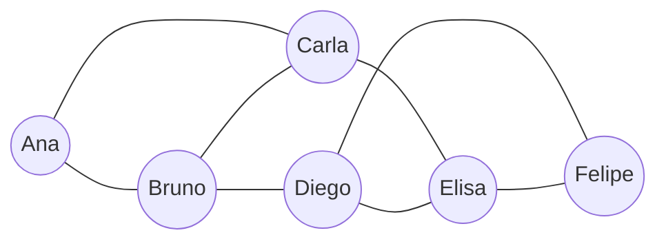

# Caderno do Estudante - Projeto ConectaUDF: Redes Sociais com Grafos
**Disciplina:** Algoritmos / Matemática Discreta / Ciência de Dados  
**Instituição:** UDF — Centro Universitário do Distrito Federal  

---

### Integrantes do Grupo:
- **Aloisio Veleda**
- **Giovanna Nascimento**
- **Guilherme Brito**
- **Isabela Cristina**
- **Julia Barreira**
- **Pedro Paulo**
- **Tiago Freire**

---

## 1. O Desafio
Você faz parte da equipe que analisa a rede social fictícia **ConectaUDF**. Sua missão é representar as amizades em um grafo, realizar cálculos e usar Python para interpretar a estrutura da rede.

---

## 2. Conceitos Essenciais
- **Vértice (ou nó):** representa um usuário.
- **Aresta:** representa uma amizade entre dois usuários.
- **Grau:** quantidade de conexões diretas de um usuário.
- **Caminho:** sequência de usuários em que cada par consecutivo está conectado.
- **Densidade:** proporção entre as amizades existentes e todas as amizades possíveis.
- **Grafo não direcionado:** as amizades são recíprocas (se Ana é amiga de Bruno, Bruno é amigo de Ana).

---

## 3. Conheça os Usuários
| Código | Usuário | Amigos |
|---|---|---|
| A | Ana | Bruno, Carla |
| B | Bruno | Ana, Carla, Diego |
| C | Carla | Ana, Bruno, Elisa |
| D | Diego | Bruno, Elisa, Felipe |
| E | Elisa | Carla, Diego, Felipe |
| F | Felipe | Diego, Elisa |

**As 8 amizades existentes são:**
1. Ana — Bruno
2. Ana — Carla
3. Bruno — Carla
4. Bruno — Diego
5. Carla — Elisa
6. Diego — Elisa
7. Diego — Felipe
8. Elisa — Felipe

---

## 4. Passo a Passo: Desenhe o Grafo

### Diagrama em Mermaid:


### Esboço em Formato de Diagrama de Conexões:
```text
          [Ana]
         /     \
    [Bruno]----[Carla]
       |          |
    [Diego]----[Elisa]
         \     /
         [Felipe]
```

---

## 5. Passo a Passo: Calcule o Grau
Conte quantas linhas chegam a cada círculo. Registre o resultado:

| Usuário | Amigos diretos | Grau |
|---|---|---:|
| **Ana** | Bruno, Carla | **2** |
| **Bruno** | Ana, Carla, Diego | **3** |
| **Carla** | Ana, Bruno, Elisa | **3** |
| **Diego** | Bruno, Elisa, Felipe | **3** |
| **Elisa** | Carla, Diego, Felipe | **3** |
| **Felipe** | Diego, Elisa | **2** |

**Pergunta 1: Quem tem mais conexões diretas?**  
**Resposta:** **Bruno, Carla, Diego e Elisa** empatam com o maior número de conexões diretas, com **grau 3** cada um.

---

## 6. Passo a Passo: Calcule o Número de Amizades
Some todos os graus. Como cada amizade conecta dois usuários, cada aresta é contada duas vezes.

**Fórmula:**  
`Número de arestas = soma dos graus ÷ 2`

1. **Soma dos graus:** $2 + 3 + 3 + 3 + 3 + 2 =$ **16**
2. **Divida por 2:** $16 \div 2 =$ **8**
3. **Quantas amizades existem no grafo?** **8 amizades**

---

## 7. Passo a Passo: Calcule a Densidade
A densidade compara as amizades existentes com o total de amizades possíveis.

Para um grafo simples não direcionado:
$$D = \frac{2 \times E}{V \times (V - 1)}$$

Substituindo os valores ($V = 6$, $E = 8$):
$$D = \frac{2 \times 8}{6 \times (6 - 1)} = \frac{16}{6 \times 5} = \frac{16}{30} = \frac{8}{15}$$

- **Resultado decimal:** **0,5333**
- **Resultado percentual:** **53,33%**

**Interprete: A rede tem poucas ou muitas das conexões possíveis? Explique com suas palavras:**  
**Resposta:** A rede possui uma densidade **moderada a alta** (53,33%), o que significa que mais da metade de todas as amizades teoricamente possíveis entre essas 6 pessoas já foram concretizadas (8 conexões reais de 15 potenciais). Isso demonstra que o grupo é bastante integrado e possui múltiplos laços em comum, mas ainda possui espaço para expansão de novas amizades diretas (como Ana com Diego, Elisa ou Felipe).

---

## 8. Passo a Passo: Represente o Grafo em Python

```python
rede = {
    "Ana": ["Bruno", "Carla"],
    "Bruno": ["Ana", "Carla", "Diego"],
    "Carla": ["Ana", "Bruno", "Elisa"],
    "Diego": ["Bruno", "Elisa", "Felipe"],
    "Elisa": ["Carla", "Diego", "Felipe"],
    "Felipe": ["Diego", "Elisa"]
}

# Quantidade de usuarios
n = len(rede)

# Calcule o grau de cada usuario
for usuario, amigos in rede.items():
    print(usuario, "tem", len(amigos), "conexoes")

# A soma dos graus conta cada amizade duas vezes
soma_graus = sum(len(amigos) for amigos in rede.values())
arestas = soma_graus // 2

print("Total de usuarios:", n)
print("Total de amizades:", arestas)

# Densidade do grafo
densidade = (2 * arestas) / (n * (n - 1))
print(f"Densidade: {densidade:.2%}")
```

### Saída esperada do código:
```text
Ana tem 2 conexoes
Bruno tem 3 conexoes
Carla tem 3 conexoes
Diego tem 3 conexoes
Elisa tem 3 conexoes
Felipe tem 2 conexoes
Total de usuarios: 6
Total de amizades: 8
Densidade: 53.33%
```

---

## 9. Passo a Passo: Encontre um Caminho
Encontre um caminho de Ana até Felipe. Cada passagem por uma linha corresponde a uma aresta.

- **Exemplo de registro:**  
  `Ana → Bruno → Diego → Felipe`

- **Quantas arestas há no caminho?**  
  **3 arestas** (as arestas Ana-Bruno, Bruno-Diego e Diego-Felipe).

- **Você encontrou outro caminho com a mesma quantidade de arestas? Qual?**  
  **Sim.** O caminho alternativo com a mesma quantidade de arestas é:  
  `Ana → Carla → Elisa → Felipe` (também possui **3 arestas**).

---

## 10. Desafio em Grupo (Ampliação da Rede Social)

### 1. Adição de quatro usuários fictícios:
- **Gabriel**
- **Helena**
- **Igor**
- **Juliana**  
*(Total de usuários agora: $V = 10$)*

### 2. Criação de no mínimo cinco novas amizades:
Criamos **7 novas amizades** (mais do que o mínimo exigido de 5):
1. **Felipe — Gabriel** *(liga o grupo antigo ao novo através de Felipe)*
2. **Gabriel — Helena** *(amizade interna entre novos membros)*
3. **Helena — Igor** *(amizade interna entre novos membros)*
4. **Igor — Juliana** *(amizade interna entre novos membros)*
5. **Juliana — Gabriel** *(amizade interna entre novos membros, fechando um ciclo)*
6. **Diego — Igor** *(segunda ponte entre os grupos)*
7. **Carla — Helena** *(terceira ponte entre os grupos)*

*(Total de amizades agora: $E = 8 + 7 = 15$ amizades)*

### 3. Lista de Adjacência atualizada em Python:
```python
rede_ampliada = {
    "Ana": ["Bruno", "Carla"],
    "Bruno": ["Ana", "Carla", "Diego"],
    "Carla": ["Ana", "Bruno", "Elisa", "Helena"],
    "Diego": ["Bruno", "Elisa", "Felipe", "Igor"],
    "Elisa": ["Carla", "Diego", "Felipe"],
    "Felipe": ["Diego", "Elisa", "Gabriel"],
    "Gabriel": ["Felipe", "Helena", "Juliana"],
    "Helena": ["Carla", "Gabriel", "Igor"],
    "Igor": ["Diego", "Helena", "Juliana"],
    "Juliana": ["Gabriel", "Igor"]
}
```

### 4. Recálculo dos graus, total de arestas e densidade:
- **Grau de cada usuário na rede ampliada:**
  - Ana: 2
  - Bruno: 3
  - **Carla: 4**
  - **Diego: 4**
  - Elisa: 3
  - Felipe: 3
  - Gabriel: 3
  - Helena: 3
  - Igor: 3
  - Juliana: 2
- **Soma dos graus:** $2 + 3 + 4 + 4 + 3 + 3 + 3 + 3 + 3 + 2 = 30$
- **Total de arestas ($E$):** $30 \div 2 = 15$ arestas.
- **Total de vértices ($V$):** 10 usuários.
- **Densidade:**  
  $$D = \frac{2 \times 15}{10 \times (10 - 1)} = \frac{30}{90} = \frac{1}{3} \approx 0{,}3333 \quad (33{,}33\%)$$

### 5. Comparação da densidade antes e depois da ampliação:
- **Densidade antes:** 53,33%
- **Densidade depois:** 33,33%
- **Análise comparativa:** A densidade caiu 20 pontos percentuais (de 53,33% para 33,33%). Isso acontece porque à medida que novos usuários entram na rede, a quantidade de amizades teoricamente possíveis cresce de forma quadrática ($V \times (V-1)/2$), enquanto as conexões reais crescem mais devagar. Por isso, grandes redes sociais da vida real são tipicamente grafos esparsos (baixa densidade).

### 6. Identificação dos usuários com mais conexões:
**Carla** e **Diego** possuem o maior número de conexões diretas, com **grau 4** cada. Eles funcionam como "hubs" e pontes de conexão entre a turma original e os novos usuários.

### 7. Como a rede poderia recomendar uma nova amizade:
A rede pode usar o princípio sociológico do **fechamento triádico** através do algoritmo de **Amigos em Comum**:
- Se dois usuários ainda não são amigos, o sistema conta quantos amigos mútuos eles compartilham.
- **Exemplo na nossa rede:** **Gabriel** e **Igor** não são amigos diretos, mas ambos são amigos de **Helena** e de **Juliana** (têm 2 amigos em comum). A rede ConectaUDF recomendaria com prioridade máxima que Gabriel e Igor se conectem!
- Da mesma forma, **Juliana** e **Helena** têm 2 amigos em comum (Gabriel e Igor), sendo outra excelente recomendação mútua.

---

## 11. Entrega
Todos os itens solicitados estão contemplados:
- Desenho do grafo (Mermaid e diagrama textual na Seção 4 e 10);
- Tabela com os graus devidamente preenchida (Seção 5 e 10);
- Cálculos passo a passo de arestas e densidade (Seções 6, 7 e 10);
- Código Python executável completo salvo no arquivo `conecta_udf.py`;
- Respostas a todas as perguntas do caderno e análise de reflexão.

---

## 12. Pergunta de Reflexão

> *"Duas pessoas ainda não são amigas, mas têm três amigos em comum. Como essa informação poderia ser usada para sugerir uma nova conexão? Quais cuidados de privacidade devem ser considerados ao analisar redes sociais?"*

### Resposta:

1. **Uso da informação para sugerir conexões:**
   - **Fechamento Triádico:** Na teoria das redes, se a pessoa $A$ é amiga de $X, Y$ e $Z$, e a pessoa $B$ também é amiga de $X, Y$ e $Z$, a chance de $A$ e $B$ se conhecerem ou pertencerem ao mesmo grupo social (como turma da faculdade, trabalho ou família) é altíssima.
   - **Algoritmo de Recomendação:** O sistema pode calcular a intersecção de vizinhança ($|\text{Amigos}(A) \cap \text{Amigos}(B)|$) e aplicar pesos com métricas como o *Índice de Jaccard* ou *Adamic-Adar*. No aplicativo, o sistema pode exibir: *"Pessoas que você talvez conheça: Fulano (3 amigos em comum)"*, facilitando a expansão da rede com alta taxa de aceitação.

2. **Cuidados de privacidade (LGPD e Segurança):**
   - **Exposição Involuntária de Círculos Sociais:** Sugerir conexões pode expor relacionamentos que os usuários preferem manter privados (ex.: revelar colegas de um trabalho anterior, grupos religiosos ou círculos íntimos).
   - **Inferência Indevida de Dados Sensíveis:** Pela análise dos amigos em comum (homofilia), algoritmos podem inferir orientação sexual, posições políticas ou condições de saúde de um usuário sem seu consentimento.
   - **Proteção contra Assédio e Perseguição (*Stalking*):** Recomendar pessoas automaticamente pode aproximar indivíduos indesejados, ex-cônjuges ou assediadores. Deve haver mecanismos para bloquear recomendações e restringir quem pode encontrá-lo.
   - **Consentimento e Opção de Opt-Out:** De acordo com a Lei Geral de Proteção de Dados (LGPD), o usuário deve ter transparência sobre como seus dados relacionais são utilizados e a liberdade de desativar a exibição da sua lista de amigos e as sugestões automáticas de conexão.
